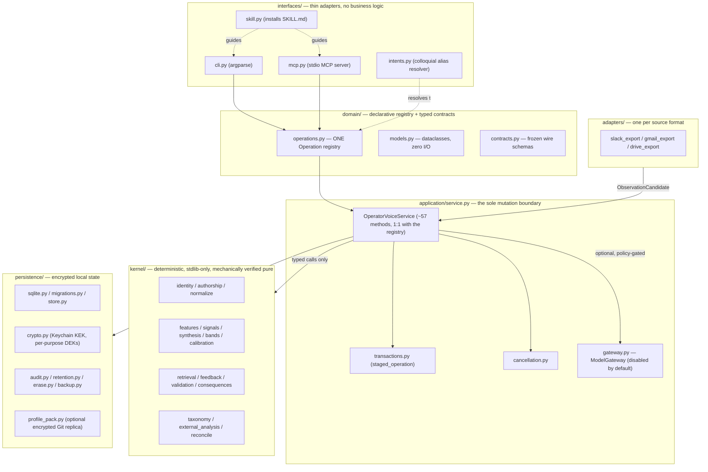

# Architecture

**Audience:** agents and engineers who need to know how OVT is built before extending, debugging, or
integrating with it. If you just want to *use* OVT, see [`docs/operating-procedures.md`](operating-procedures.md)
or the [documentation map](README.md).

**Authority:** this describes the system **as implemented** at `v0.1.5` (GA, M1–M5 complete). Where the
build plan (`operator-voice-toolkit-build-plan.md` in `KleinPerkins/dev`) and the code disagree, the code
wins and the gap is noted explicitly below (see [Known gaps](#known-gaps)). `src/operator_voice/__init__.py`
and `src/operator_voice/persistence/crypto.py` both cite this file by name — it did not previously exist;
this is the first version.

## Layering

OVT is a single Python 3.12 package (`operator_voice`) with one hard rule: **the kernel is a pure
function of its inputs — no I/O, no network, no model calls.** Everything stateful or external sits
outside it and calls in.

Component boundaries are not just convention — two are mechanically enforced by tests, not merely
documented:

- **Kernel purity**: `tests/unit/test_kernel_purity.py` AST-parses every file under
  `src/operator_voice/kernel/` and fails if any module imports `application`, `adapters`, `interfaces`,
  `persistence`, `runtime`, or a denylisted network/model module (`socket`, `requests`, `openai`,
  `anthropic`, `boto3`, …). This is a structural guarantee, checked whether or not a given code path is
  otherwise exercised by a unit test.
- **Adapter isolation**: `adapters/conformance.py` runs a structural check per adapter type that denies
  any import of `persistence.store`/`crypto`/`sqlite` or raw `sqlite3` — adapters can only return typed
  candidates to the application service; they cannot touch the database.

### Why this shape

The three audited prior-art repos (see [`docs/audit-provenance.md`](audit-provenance.md)) each collapsed
collection, inference, and application into one undifferentiated layer with no enforced mutation
boundary. OVT's layering is a direct, deliberate correction of that: **one** place decides policy (the
kernel), **one** place is allowed to mutate state (the application service), and every interface —
present or future — is a thin translation over the same registry.

## Components

| Layer | Path | Responsibility |
|---|---|---|
| Domain | `src/operator_voice/domain/` | `operations.py` — the one `Operation` registry CLI/MCP/docs all derive from; `models.py` — dataclasses for every entity (zero I/O); `contracts.py` — frozen wire schemas (`VoiceContextBundle/v1`, `SubjectInsightBundle/v1`); `help.py` — deterministic `help` ranking. |
| Kernel | `src/operator_voice/kernel/` | 15 modules: `identity`, `authorship`, `normalize`, `features`, `signals`, `synthesis`, `retrieval`, `feedback`, `validation`, `consequences`, `bands`, `calibration`, `external_analysis`, `reconcile`, `taxonomy`. No I/O; see [System mechanics](system-mechanics.md) for the pipeline these implement. |
| Application | `src/operator_voice/application/` | `service.py` — `OperatorVoiceService`, ~1850 lines, one method per registry operation; this is the **only** code path allowed to call `persistence.store` (no direct store access exists anywhere in `adapters/` or `interfaces/`). `transactions.py` wraps every mutation in a staged, audited transaction. `cancellation.py` is the cooperative off-switch. `gateway.py` is the optional model gateway. |
| Adapters | `src/operator_voice/adapters/` | `registry.py` dispatches by type to 3 scanners (`slack_export`, `drive_export`, `gmail_export`). Shared helpers in `base.py` (path-traversal guard, size caps, active/paused check). `slack_export` reads agent-materialized, server-author-verified Markdown (see [`docs/slack-adapter.md`](slack-adapter.md)) — never Slack's own API; `drive_export` reads agent-delegated, server-owner-verified, owner-only Drive files (see [`docs/drive-adapter.md`](drive-adapter.md)); `gmail_export` reads agent-delegated, server-author-verified Sent mail (see [`docs/gmail-adapter.md`](gmail-adapter.md)) — never Google's own API, zero OVT credentials. |
| Persistence | `src/operator_voice/persistence/` | `sqlite.py`/`migrations.py` (schema v5, 23 tables) / `store.py` (the one typed repository, ~85 functions — every encrypted column is read/written only here) / `crypto.py` (envelope encryption, see [Crypto](#crypto)) / `audit.py` (content-free journal) / `retention.py` / `erase.py` (scoped sink-registry erasure) / `backup.py` / `portability.py` (cross-machine export/import) / `profile_pack.py` (optional encrypted Git replica). |
| Interfaces | `src/operator_voice/interfaces/` | `cli.py` (argparse, one subcommand per operation), `mcp.py` (stdio MCP server, read-only by default), `intents.py` (colloquial alias table, router-off fallback), `skill.py` (installs the packaged `SKILL.md` into `.cursor`/`.claude`/`.codex`). |
| Runtime | `src/operator_voice/runtime/` | `paths.py` (XDG layout), `bootstrap.py` (`open_runtime()`, the one shared entrypoint CLI/MCP both use), `receipt.py`, `install.py`/`install_cli.py` (atomic install/repair), `payload.py` (content-addressed portable-payload builder), `requirements.py` (single source of truth for pinned deps), `scheduler.py` (local-jobs command planner — read-only). |
| Eval | `src/operator_voice/eval/` | `manifest.py` (the frozen, digest-pinned 10-dimension GA scoring formula), `metrics.py`, `coverage.py`, `benchmarks.py`, `calibrate.py`/`calibration_manifest.py`. Real, executable evidence-collection code, not just a scoring description — see [Product requirements](product-requirements.md#success-criteria). |
| Dashboard | `src/operator_voice/dashboard/` | `generate.py` — a pure string-builder that renders a redacted, read-only Cursor Canvas from `service.dashboard_data()`. No mutation path exists in the generated artifact. |
| Docs generator | `src/operator_voice/docs/` | `generate.py`/`resources.py`/`prompts.py` — regenerate everything under `docs/generated/` from the operation/resource/prompt registries. Never hand-edit `docs/generated/**`. |

## The one operation registry

Every capability OVT exposes is declared exactly once in `domain/operations.py` as an `Operation`
(`name`, `group`, `posture`, `args`, `mcp_exposed`, `mutation_tool`). Three properties derive the
surface-specific names from that one dotted name (e.g. `profile.publish`):

| Derived name | Rule | Example |
|---|---|---|
| `handler_name` | dots → underscores | `OperatorVoiceService.profile_publish` |
| `cli_name` | dots → dashes | `operator-voice profile-publish` |
| `mcp_name` | dots → underscores | MCP tool `profile_publish` |

Both `interfaces/cli.py` and `interfaces/mcp.py` dispatch with `getattr(runtime.service, op.handler_name)`
— there is no second, divergent implementation per surface. Adding a verb means editing the registry and
the service once; CLI, MCP, generated docs (`docs/generated/`), and `help` all pick it up automatically
(`python -m operator_voice.docs.generate docs/generated` regenerates them; a checked-in-content test,
`tests/unit/test_docs_and_skill.py`, fails if the committed output is stale).

The generated registry index records the current operation counts, groups and postures. Lifecycle
operations remain CLI-only because exposing them to an agent tool is unnecessary authority. See
the full table in [`docs/generated/INDEX.md`](generated/INDEX.md).

## Deterministic kernel vs. the injected, default-off model gateway

This is the single most important structural decision in OVT, because every audited prior-art repo
blurred it (see [`docs/audit-provenance.md`](audit-provenance.md)):

- **The kernel never calls a model.** `kernel/synthesis.py`, `kernel/validation.py`, etc. compute facts,
  confidence, and validation outcomes from typed inputs only. This is the same structural guarantee
  enforced by `test_kernel_purity.py` above.
- **`application/gateway.py`'s `ModelGateway` is a separately injected, optional collaborator** —
  disabled by default (`DISABLED_GATEWAY = ModelGateway(enabled=False)`, `gateway.py:266`) and never
  constructed as enabled by any application code path (a structural grep guard in
  `tests/unit/test_gateway.py` checks this). When explicitly configured, it still cannot see raw or
  quarantined text (`INELIGIBLE_DATA_CLASSES = {"raw", "quarantined"}`, checked first, `gateway.py:38,191`).
- **Two independent egress switches**, not one: `operator_egress_enabled` and `external_egress_enabled`
  (`gateway.py:193,196-200`). Enabling operator-subject model review never enables `EXTERNAL`-subject
  egress — that is always a second, explicit switch. See
  [Product requirements → egress](product-requirements.md#invariants-and-guarantees).
- **Zero payload retention is structural, not a policy promise**: `ModelCallRecord`
  (`domain/models.py:613`) has no text/signal/payload field at all — only provider, model, data class,
  purpose, outcome, duration, and cancellation state. There is nothing in the schema *capable* of storing
  the content sent to a model.
- OVT ships no network client of its own; the gateway bundles a `LocalDeterministicProvider` (no network)
  and a generic `CallableProvider` for an operator-injected adapter.

If you are extending OVT and are tempted to have a kernel module "just quickly check something with a
model" — don't. That call belongs in the application service, behind the gateway, gated by the policy
above.

## XDG runtime and the atomic install contract

| Purpose | Path | Set by |
|---|---|---|
| Config | `${XDG_CONFIG_HOME:-~/.config}/operator-voice` | `runtime/paths.py` |
| Installed runtime slots + `current` symlink + local SQLite DB | `${XDG_DATA_HOME:-~/.local/share}/operator-voice` | `runtime/paths.py`, `runtime/install.py` |
| Install receipt, backups, profile-pack clone | `${XDG_STATE_HOME:-~/.local/state}/operator-voice` | `runtime/paths.py` |

Runtime install/repair is content-addressed and atomic (`runtime/install.py`, `runtime/payload.py`):

1. `payload.py` builds a deterministic snapshot of `.py`/`.md`/`.json`/`.toml` files only (hard denylist —
   `.sqlite3`/`.env`/`.pem`/`.key` — *raises* if any such file is anywhere in the source tree, not just
   excluded from the copy) and hashes it (sha256 over sorted `(relpath, content)` pairs).
2. `install_runtime()` writes a new immutable slot at `runtime/<version>-<digest12>/` and swaps the
   `current` symlink with a single atomic `os.replace`.
3. The receipt (`runtime/receipt.py`) is `{schema: "install-receipt/v1", version, digest, installed_at,
   source}` and is written **last** — a crash before that point leaves the prior healthy runtime in place.
4. Convergence rules: same version + same digest → no-op; same version + different digest → refused
   ("possible tamper"); lower version over a healthy current → refused (no silent downgrade).
5. `repair_runtime()` can **only** re-verify/replace the payload under `runtime/` — it has no reference to
   any config/state/key/profile path in its call signature, so it structurally cannot touch them.

This is what lets two independent distributors — a direct home install and the cpp-vendored payload —
converge on the same runtime without a manager hierarchy. See
[Topology → ecosystem integration](topology.md#ecosystem-integration) for how the second distributor is
produced and delivered.

## Data model (summary)

Full entity list and DB-table detail lives in code (`domain/models.py`, `persistence/migrations.py`); this
is a routing summary. See [System mechanics](system-mechanics.md#the-canonical-lifecycle) for how these
are populated end-to-end.

`SubjectRegistration` / `SubjectAlias` → `SourceRegistration` → `SourceDocument` → `SignalObservation` →
`ProfileFact` (states `OBSERVED → SUPPORTED → CONFIRMED/CORRECTED → DEPRECATED`) → `ProfileGeneration`
(pinned version bundle + digest) → `VoiceContextBundle` (read-time, `context.get`) /
`SubjectInsightBundle` (read-time, `subject.insights`, `EXTERNAL` only). Alongside: `FeedbackEvent`
(durable correction memory), `ReviewItem` (contradiction/drift queue), `ValidationRun`, `ModelCallRecord`,
`AuditEvent`, `OperationChallenge`, `ExportManifest`, `CancellationState`, `ProfileBackendConfig` /
`ProfileSyncState` / `ProfilePackManifest` (optional `ENCRYPTED_GIT` backend only), and the M3 curation
entities (`CurationRun`, `SourceCurationState`).

## Crypto

Envelope encryption (`persistence/crypto.py`), not a modified/compiled SQLite build — content stays in
ordinary `sqlite3` columns as ciphertext blobs, keeping the dependency footprint small and auditable.

- **KEK** (Key-Encryption-Key): one random 256-bit key per install, held **only** in the OS Keychain
  (`MacKeychainKeyStore`, which shells directly to the macOS `security` CLI rather than a third-party
  keyring library, "so the entire Keychain interaction surface is a handful of reviewable lines"). It
  never encrypts content directly.
- **DEK** (Data-Encryption-Key): one random 256-bit key per *key generation*, scoped by **purpose**
  (content vs. profile-pack are separate generations — a real cross-contamination bug here was found and
  fixed during M1; see `docs/m1-implementation-ledger.md` worklist item 4). All sensitive content is
  AES-256-GCM-encrypted under the current DEK; the DEK itself is wrapped by the KEK and stored (safely
  useless without the KEK) in the local database.
- **Rotation / crypto-shredding**: rotating creates a new generation and wraps a fresh DEK; destroying a
  generation deletes its wrapped-DEK row. Ciphertext still encrypted under a destroyed DEK becomes
  permanently unrecoverable — this is precisely what "erasure of historical ciphertext" means in places
  (e.g. old Git history) where the ciphertext bytes themselves cannot be scrubbed. See
  [Product requirements → erasure](product-requirements.md#invariants-and-guarantees).
- Field-level, not whole-file: every column that could carry raw text, feature values, prompts, or PII is
  encrypted; IDs/timestamps/enums used purely for indexing stay in the clear. Three plaintext-at-rest gaps
  found by an independent M1 security review (`feedback_events.reason`, `sources.canonical_root`,
  `documents.locator`) were fixed and are now regression-tested by
  `tests/integration/test_no_plaintext_content.py`, which asserts the raw SQLite row for each column never
  contains the real value.

## Testing architecture

Beyond ordinary unit coverage, three test classes exist specifically to keep architectural invariants from
silently drifting:

- **Structural/purity tests** (`tests/unit/test_kernel_purity.py`) — AST-based, not execution-based; hold
  even for code paths nothing else exercises.
- **Contract-freeze tests** (`tests/contract/`) — `test_voice_context_bundle_freeze.py` pins the
  `VoiceContextBundle/v1` required-field set and version-negotiation rule; `test_template_framework_fixture.py`
  proves a stdlib-only external consumer fixture never imports OVT internals and vice versa (protecting
  the seam described in [Topology](topology.md#template-framework-seam)).
- **Adversarial/security tests** (`tests/security/`) — authorship/quarantine-smuggling and `EXTERNAL`
  egress-default-deny fixtures, plus a zero-network-I/O proof for `LOCAL_ONLY` curation.

## Known gaps

Documentation must describe the code as it is, not as the build plan originally sketched it. Two
domain-model concepts named in the build plan differ from what actually shipped:

- **`EvidenceRecord`** exists as a dataclass (`domain/models.py`) and a DB table
  (`migrations.py`, included in the `erase.py` cascade), but is **never instantiated** anywhere in
  `src/` or `tests/`. Synthesis goes `SignalObservation → ProfileFact` directly; there is no intermediate
  evidence-aggregation row populated today. Treat `EvidenceRecord` as reserved schema, not a live entity.
- **`ContextTaxonomy`** is not a single named class. The build plan's concept is split across
  `domain/models.py`'s `ContextScope` (the M1 slice — channel/audience/purpose/language actually attached
  to a fact) and `kernel/taxonomy.py` (the M2+ MYNAH-derived vocabulary/disambiguation data). A future
  reader looking for "the `ContextTaxonomy` class" should look at these two instead.
- **No MCP launch wiring ships.** `pyproject.toml` registers a console script for the CLI
  (`operator-voice = "operator_voice.interfaces.cli:main"`) but none for the MCP server. `interfaces/mcp.py`
  is fully implemented (`python -m operator_voice.interfaces.mcp` inside the installed venv, with
  `runtime/current` on `PYTHONPATH`), but a host must configure that command itself — no installer step
  writes an MCP host config file. See [backlog](README.md#documentation-backlog).

## Future expansion and extension points

See [System mechanics → extension points](system-mechanics.md#extension-points-for-future-work) for the
concrete places new adapters, signals, and consumers plug in, and the invariants any such change must
preserve.
